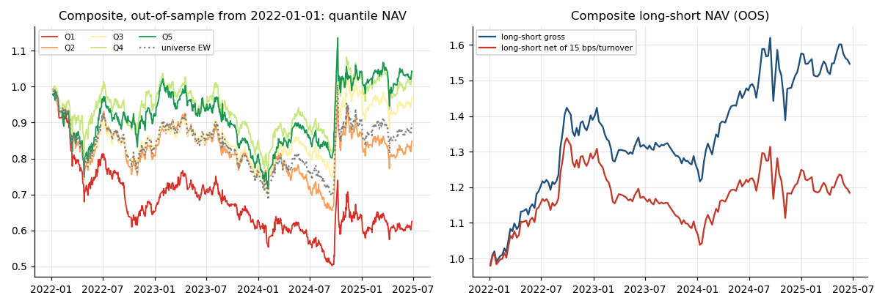

# a-share-factor-pipeline

A reproducible cross-sectional equity factor research pipeline for China A-shares (CSI 300): data → factor
construction → preprocessing → IC / RankIC / ICIR → IC decay → quantile (layered) backtest with costs → in-sample
factor selection → out-of-sample composite evaluation → tear-sheet report. One command regenerates every number and
figure in [`reports/REPORT.md`](reports/REPORT.md).

## Results

**Setup.** Point-in-time CSI 300 universe, 2018-01 → 2025-06: 545 distinct stocks, 289 eligible per day on
average. 10 price/volume factors. Signals at close *t* are traded at open *t+1* and evaluated on 5-day
forward returns. Quintile portfolios are rebalanced every 5 days, with 15 bps charged per unit of turnover.
In-sample (IS) is 2018–2021 and out-of-sample (OOS) is 2022-01 → 2025-06.

### Out-of-sample composite

The composite averages the factors whose in-sample |t| ≥ 2: `size` (large caps first), `pv_corr_20`
(negative price-volume correlation first) and `rev_5`. Each factor's sign is fitted on in-sample data only.

| Metric (OOS, 2022-01 → 2025-06) | Value |
|---|---|
| RankIC mean | **0.032** |
| ICIR per 5-day period / annualized | **0.20 / 1.44** |
| t-stat (non-overlapping periods) | **3.47** |
| Quintile monotonicity (Spearman of rank vs. return) | **1.00** |
| Q5 − Q1 annualized return, gross / net of costs | 14.0% / 5.2% |
| Q5 − Q1 Sharpe, gross / net | 0.97 / 0.42 |
| Top quintile excess return vs. equal-weight universe | 4.3% / yr (IR 0.59) |



### Single factors (full sample; RankIC is the raw, unflipped sign)

| Factor | RankIC | ICIR (ann.) | t | RankIC IS → OOS | Q5−Q1 gross | Q5−Q1 net |
|---|---:|---:|---:|---|---:|---:|
| `pv_corr_20` | −0.027 | −1.35 | −3.10 | −0.030 → −0.025 | 11.2% | 4.0% |
| `turn_20` | −0.037 | −1.42 | −3.74 | −0.020 → −0.055 | 8.3% | 6.5% |
| `amihud_20` | 0.020 | 1.04 | 2.62 | 0.012 → 0.029 | 6.7% | 4.7% |
| `size` | 0.030 | 1.20 | 3.17 | 0.025 → 0.036 | 4.3% | 3.4% |
| `range_20` | −0.045 | −1.45 | −3.82 | −0.016 → −0.077 | 3.9% | 1.4% |
| `vol_20` | −0.038 | −1.30 | −3.25 | −0.016 → −0.063 | 1.0% | −2.4% |
| `mom_20` | −0.021 | −0.79 | −2.10 | −0.022 → −0.020 | 2.5% | −3.5% |
| `rev_5` | 0.009 | 0.37 | 1.48 | 0.018 → −0.001 | 0.1% | −11.1% |

The full table (10 factors plus the composite), IC decay, factor correlations and a tear sheet per factor are in
[`reports/REPORT.md`](reports/REPORT.md).

What the results show:
- **Stability across periods.** `pv_corr_20` is the most stable signal: its IS and OOS ICs are close, and its
  quintiles are perfectly monotone. `rev_5` passed the in-sample filter, but its OOS IC is about zero and its
  turnover (~80% per rebalance) costs about 11% a year.
- **Regime dependence.** The volatility and liquidity factors (`vol_20`, `range_20`, `turn_20`) were weak in-sample.
  After 2022 they became much stronger, with low-risk, low-attention stocks winning. `range_20` alone reached an
  OOS RankIC of −0.077. The composite deliberately excludes it because it failed the in-sample test, so the
  OOS evaluation stays clean.
- **Costs.** Costs cut the composite's OOS long-short return from 14.0% to 5.2% a year, nearly two-thirds. Turnover
  matters as much as IC here.

### Survivorship bias check

A common shortcut is to use today's index members for the whole history. It changes the conclusions substantially
([`reports/survivorship_bias.md`](reports/survivorship_bias.md), reproduced by `scripts/survivorship_check.py`):

| Factor | Universe = end-of-sample constituents | Point-in-time universe |
|---|---|---|
| `size` | small caps win, Q5−Q1 **22.5%/yr**, Sharpe 1.28 | sign **flips**: large caps win, 4.3%/yr |
| `vol_20` | high-vol stocks win, 10.2%/yr | sign flips, 1.0%/yr |
| `turn_20` | −4.4%/yr | 8.3%/yr |

Stocks that were small in 2018 and are in today's index are, almost by construction, the ones that grew. A
backtest on today's list therefore rewards "small" and "volatile" with hindsight.

## Methodology

**Universe (point in time, survivorship-bias aware).** Weekly CSI 300 membership snapshots from baostock
(2018-01 → 2025-06). The stock list is every name that was a member at any point, *including those later removed
or delisted*, and a stock is only eligible on dates when it was actually in the index. Also excluded: suspended
days and the first 60 trading days after listing.

**Timing (no look-ahead).** Factors use data up to the close of day *t*. Positions are entered at the **open of
*t+1*** and the *h*-day forward return is `open[t+1+h] / open[t+1] − 1`. Stocks that are suspended on *t+1*, or open
at the limit-up price (10% main board; 20% ChiNext after 2020-08-24 and STAR), cannot be bought and are dropped from
that rebalance.

**Preprocessing (per date, cross-sectional).** MAD winsorization (median ± 5 × 1.4826 × MAD) → z-score →
OLS neutralization against log float market cap → z-score.

**IC statistics.**
- IC = Pearson, RankIC = Spearman correlation between factor and forward return, per date.
- ICIR = mean(IC) / std(IC); annualized ICIR = ICIR × √(252 / h).
- t-statistics use **non-overlapping** periods only (every *h*-th date), since overlapping *h*-day returns inflate
  naive t-stats by roughly √h.
- IC decay: mean RankIC at horizons 1, 2, 5, 10, 20 days.

**Quantile (layered) backtest.** Every 5 days, eligible stocks are sorted into 5 equal-weight groups (Q1 = lowest
factor). Each group is bought at the next open and held buy-and-hold until the next rebalance, so daily NAV reflects
weight drift exactly. Long-short = Q5 − Q1. One-way turnover at each rebalance is `0.5 × Σ|w_target − w_drifted|`,
which counts both replaced names and the trades needed to restore equal weights. Costs are charged at 15 bps per unit
of one-way turnover (commission + stamp duty + slippage, approximate).

**In-sample / out-of-sample.** 2018–2021 is in-sample, 2022-01 → 2025-06 out-of-sample. Each factor's sign and the
composite's membership (in-sample |t| ≥ 2) are fitted on in-sample data only; the composite is an equal-weight
average of the selected, sign-aligned factors and is evaluated **only** on the out-of-sample period.

## Factors

| Name | Definition | Idea |
|---|---|---|
| `mom_20` | close / close₋₂₀ − 1 | 1-month momentum (reversal in A-shares) |
| `mom_120_skip20` | close₋₂₀ / close₋₁₂₀ − 1 | medium-term momentum, skipping the last month |
| `rev_5` | −(close / close₋₅ − 1) | 1-week reversal |
| `vol_20` | std of daily returns, 20d | low-volatility anomaly |
| `turn_20` | mean turnover rate, 20d | attention / liquidity |
| `abn_turn` | mean turnover 5d / mean turnover 60d − 1 | abnormal attention |
| `amihud_20` | mean(|ret| / traded value), 20d | illiquidity premium |
| `pv_corr_20` | corr(close, volume), 20d | price-volume divergence |
| `range_20` | mean((high − low) / close), 20d | intraday range / volatility |
| `size` | log float market cap | size effect (not size-neutralized) |

Adding a factor is one function in [`qfp/factors.py`](qfp/factors.py) plus one entry in `FACTORS`.

## Reproduce

```bash
pip install -e ".[data,dev]"
python scripts/download_data.py --start 20180101 --end 20250630   # first run 1-2 h (rate-limited free APIs), resumable
python -m qfp.pipeline --config configs/default.yaml                # ~30 s -> reports/
python scripts/survivorship_check.py                                # -> reports/survivorship_bias.md
pytest -q                                                           # offline, synthetic data
```

`data/membership_weekly.csv` (the point-in-time membership snapshots, ~20 min to fetch from baostock) is committed,
so the downloader only has to fetch price bars. The price cache itself (`data/raw/`) is not committed.

The tests do not need network access: they run on a synthetic panel with a **planted** signal and check that the
evaluator recovers it (positive IC, monotone quantiles), that pure noise gives IC ≈ 0, that a perfect-foresight
factor gives IC = 1 (return alignment), that same-day information shows no forward IC (no look-ahead), that the
buy-and-hold daily NAV compounds exactly to the per-period returns, and that limit-up / suspension / point-in-time
membership masks behave as specified.

## Layout

```
qfp/
  data.py         membership snapshots (baostock), daily bars (Sina via akshare), parquet cache, Panel
  factors.py      factor library
  preprocess.py   universe, tradability, winsorize / z-score / neutralize
  evaluate.py     forward returns, IC / RankIC / ICIR, IC decay, quantile backtest, performance stats
  pipeline.py     config-driven orchestration, in-sample selection, OOS composite
  report.py       summary tables (CSV / Markdown / JSON) and figures
configs/default.yaml   the exact settings behind reports/
scripts/download_data.py
tests/          pytest suite on synthetic data
```

## Limitations

- **Universe.** CSI 300 large caps only; the results do not carry over to small caps, where many of these factors are
  much stronger. Delisted stocks are held flat after their last traded price, so delisting losses that occur after
  the last trade are not captured (rare for index members).
- **Costs and capacity.** A flat cost per unit turnover; no market-impact model, no borrow cost for the short leg
  (A-share shorting is restricted, so the long-short spread is a *measure of factor strength*, not a tradable
  strategy; the long-only top-quantile excess return is the more realistic number).
- **Neutralization.** Size only. Industry neutralization would need a point-in-time industry classification, which is
  not in the free data sources used here.
- **Prices.** Backward-adjusted (hfq) prices from a free source; corporate-action handling is the vendor's.
