# Factor research report

Universe: point-in-time CSI 300 members (545 distinct stocks, avg. 289 eligible per day), 2018-01-02 to 2025-06-30. Signals at close *t*, traded at open *t+1*; 5-day forward open-to-open returns; 5 equal-weight quantiles rebalanced every 5 days; costs 15 bps per unit one-way turnover. Factors are MAD-winsorized, z-scored and size-neutralized. In-sample (IS) before 2022-01-01, out-of-sample (OOS) after.

## Out-of-sample composite (headline)

Members (selected by in-sample |t| ≥ 2.0, signs from IS): `rev_5`, `pv_corr_20`, `size`

| Metric | Value |
|---|---|
| RankIC (OOS) | 0.0324 |
| ICIR per period / annualized | 0.203 / 1.44 |
| t-stat (non-overlapping) | 3.47 |
| Long-short ann. return gross / net | 14.0% / 5.2% |
| Long-short Sharpe gross / net | 0.97 / 0.42 |
| Long-short max drawdown | -14.5% |
| Top quantile excess vs universe (ann.) | 4.3% (IR 0.59) |
| Quantile monotonicity | 1.00 |

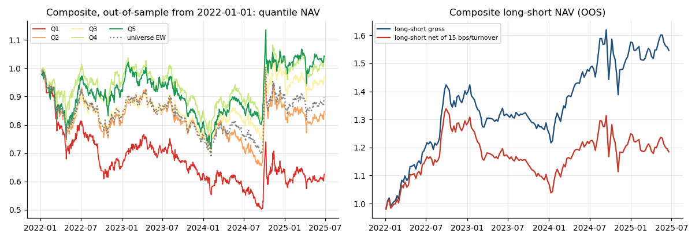

## IC / ICIR (full sample)

`Dir` is the sign fitted in-sample; quantile backtests use the sign-aligned factor so the top quantile is always the expected winner. ICIR = mean / std of the per-date RankIC; annualized ICIR scales by √(252/5); t-stat uses non-overlapping periods only.

| Factor | Dir | RankIC | ICIR | ICIR (ann.) | t | IC>0 | RankIC IS | RankIC OOS | Monotonic |
|---|---|---|---|---|---|---|---|---|---|
| mom_20 | − | -0.0207 | -0.111 | -0.785 | -2.102 | 46.7% | -0.0218 | -0.0196 | 0.900 |
| mom_120_skip20 | + | 0.0081 | 0.0410 | 0.291 | 0.699 | 53.8% | 0.0152 | 0.0009 | 0.300 |
| rev_5 | + | 0.0089 | 0.0518 | 0.368 | 1.479 | 49.8% | 0.0177 | -0.0007 | 0.400 |
| vol_20 | − | -0.0382 | -0.183 | -1.296 | -3.251 | 43.3% | -0.0160 | -0.0626 | 0.500 |
| turn_20 | − | -0.0367 | -0.200 | -1.419 | -3.742 | 43.8% | -0.0202 | -0.0547 | 1.000 |
| abn_turn | − | -0.0125 | -0.0956 | -0.679 | -1.471 | 46.5% | -0.0116 | -0.0134 | -0.500 |
| amihud_20 | + | 0.0201 | 0.146 | 1.037 | 2.618 | 55.4% | 0.0122 | 0.0288 | 0.500 |
| pv_corr_20 | − | -0.0274 | -0.189 | -1.345 | -3.095 | 41.7% | -0.0296 | -0.0251 | 1.000 |
| range_20 | − | -0.0450 | -0.205 | -1.453 | -3.822 | 43.1% | -0.0161 | -0.0765 | 0.900 |
| size | + | 0.0302 | 0.169 | 1.200 | 3.167 | 58.5% | 0.0250 | 0.0358 | 0.900 |
| composite | + | 0.0350 | 0.218 | 1.548 | 4.113 | 59.1% | 0.0374 | 0.0324 | 1.000 |

## Quantile backtest (full sample)

| Factor | L/S ann. (gross) | L/S Sharpe | L/S MaxDD | L/S ann. (net) | L/S Sharpe (net) | Top excess ann. | Top IR | Top turnover |
|---|---|---|---|---|---|---|---|---|
| mom_20 | 2.5% | 0.227 | -39.1% | -3.5% | -0.103 | 0.3% | 0.0775 | 42.0% |
| mom_120_skip20 | -0.2% | 0.0890 | -48.6% | -3.2% | -0.0694 | -0.6% | 0.0035 | 19.6% |
| rev_5 | 0.1% | 0.0874 | -37.1% | -11.1% | -0.626 | -1.6% | -0.127 | 79.6% |
| vol_20 | 1.0% | 0.146 | -46.1% | -2.4% | -0.0299 | -0.1% | 0.0349 | 20.6% |
| turn_20 | 8.3% | 0.529 | -34.2% | 6.5% | 0.436 | 3.2% | 0.438 | 10.1% |
| abn_turn | -3.3% | -0.219 | -29.7% | -10.6% | -0.861 | -2.0% | -0.250 | 48.7% |
| amihud_20 | 6.7% | 0.565 | -27.7% | 4.7% | 0.416 | 1.5% | 0.275 | 11.6% |
| pv_corr_20 | 11.2% | 0.824 | -26.3% | 4.0% | 0.351 | 5.6% | 0.737 | 43.1% |
| range_20 | 3.9% | 0.286 | -54.0% | 1.4% | 0.170 | 1.6% | 0.207 | 13.2% |
| size | 4.3% | 0.335 | -25.8% | 3.4% | 0.286 | 1.3% | 0.202 | 3.7% |
| composite | 7.7% | 0.565 | -22.5% | -0.4% | 0.0500 | 3.6% | 0.465 | 47.5% |

## Factor correlation

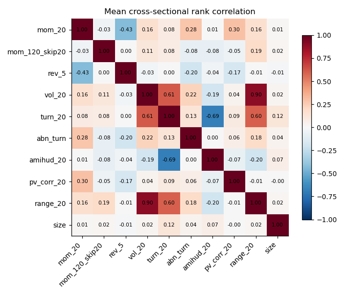

## Per-factor tear sheets

### mom_20

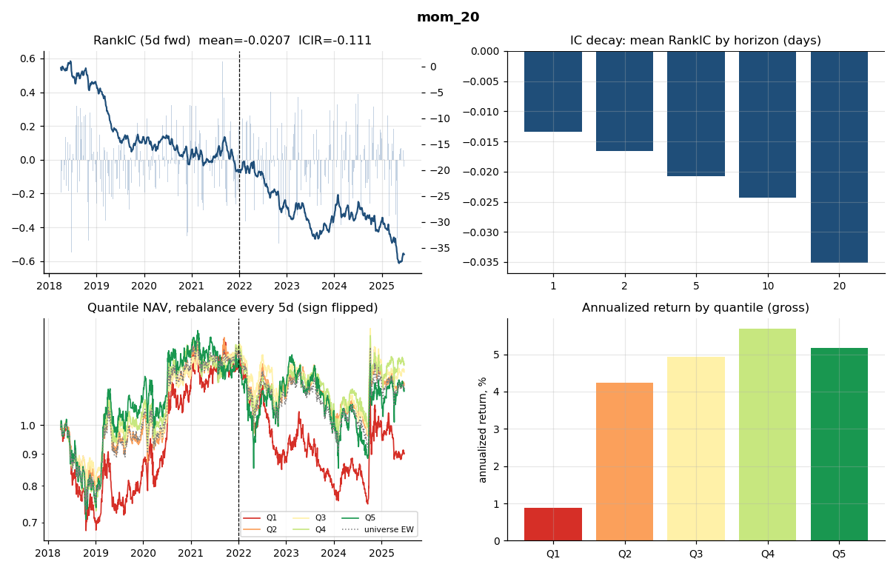

### mom_120_skip20

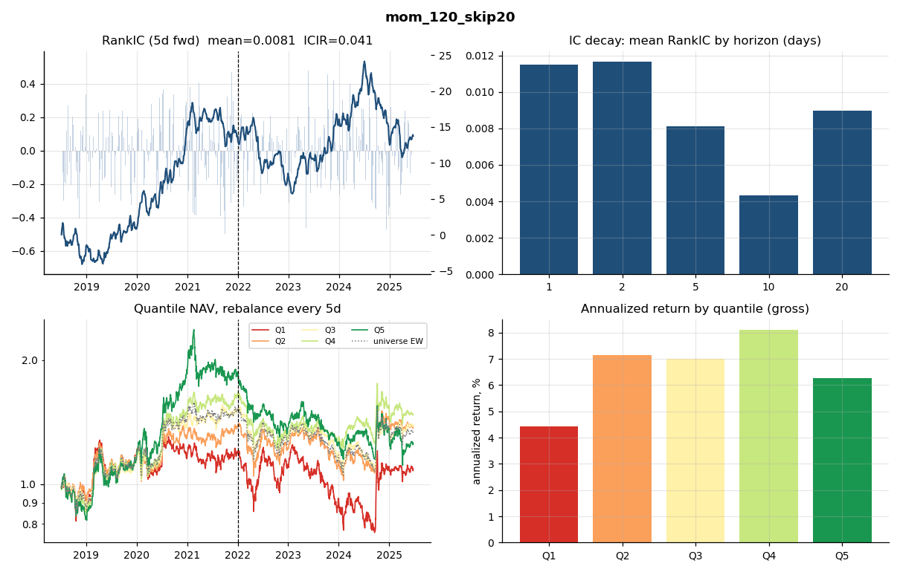

### rev_5

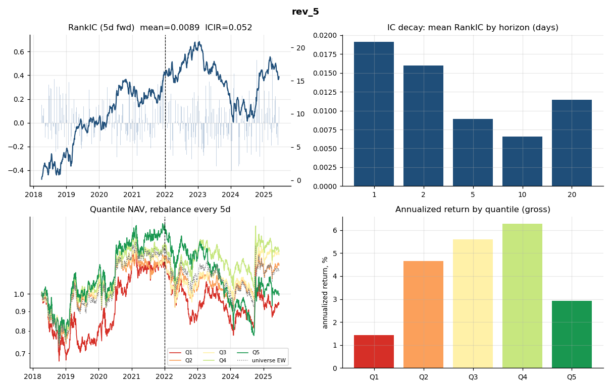

### vol_20

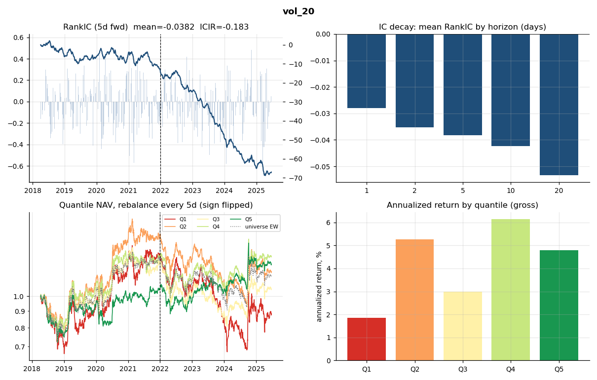

### turn_20

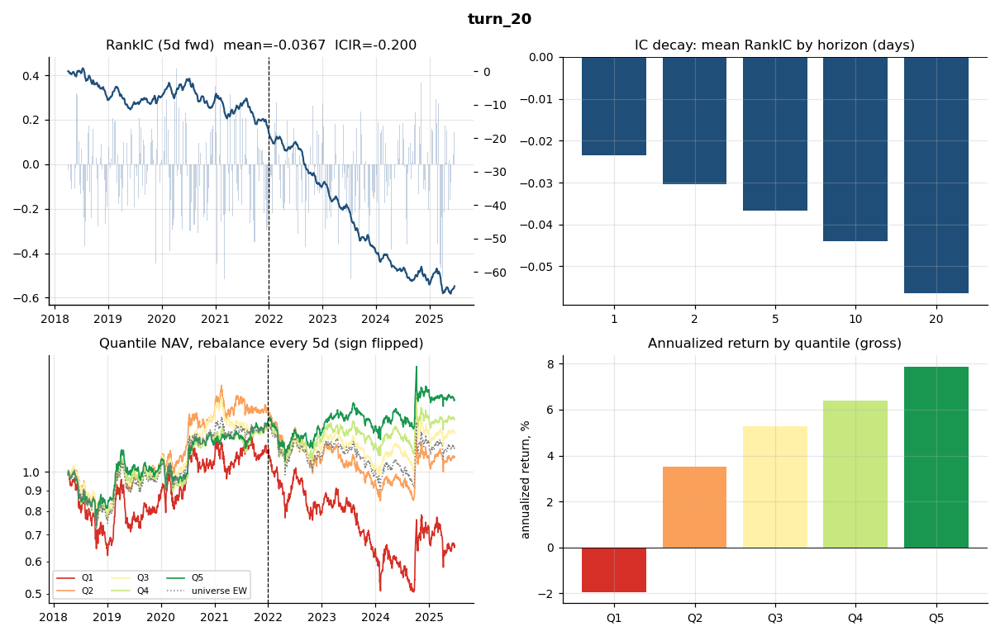

### abn_turn

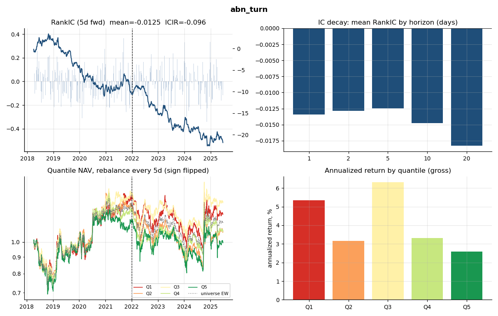

### amihud_20

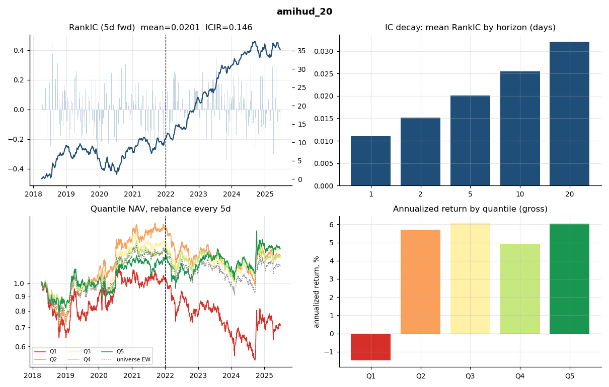

### pv_corr_20

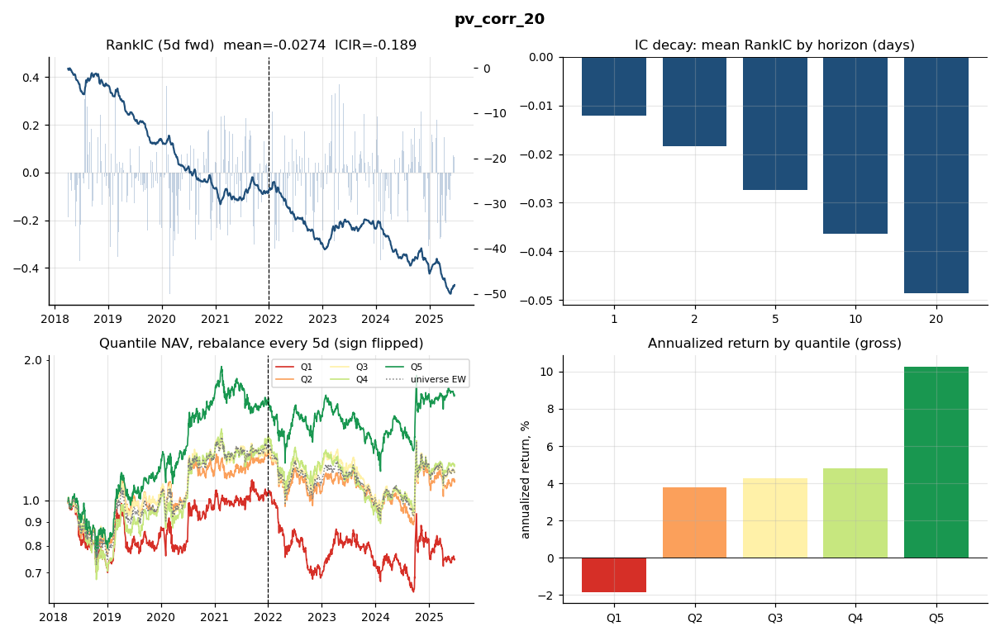

### range_20

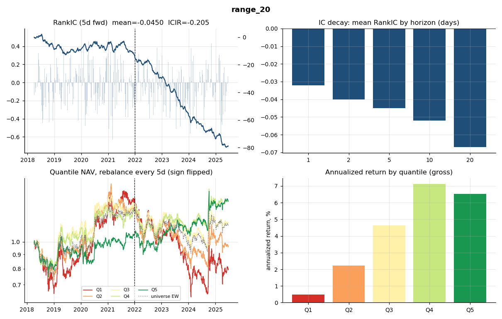

### size

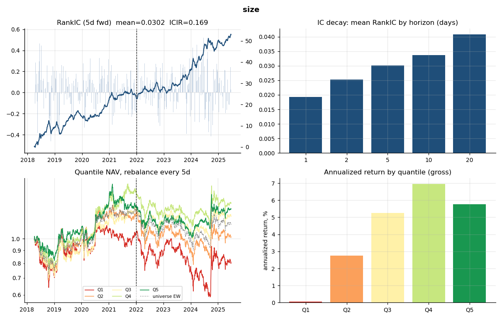

### composite

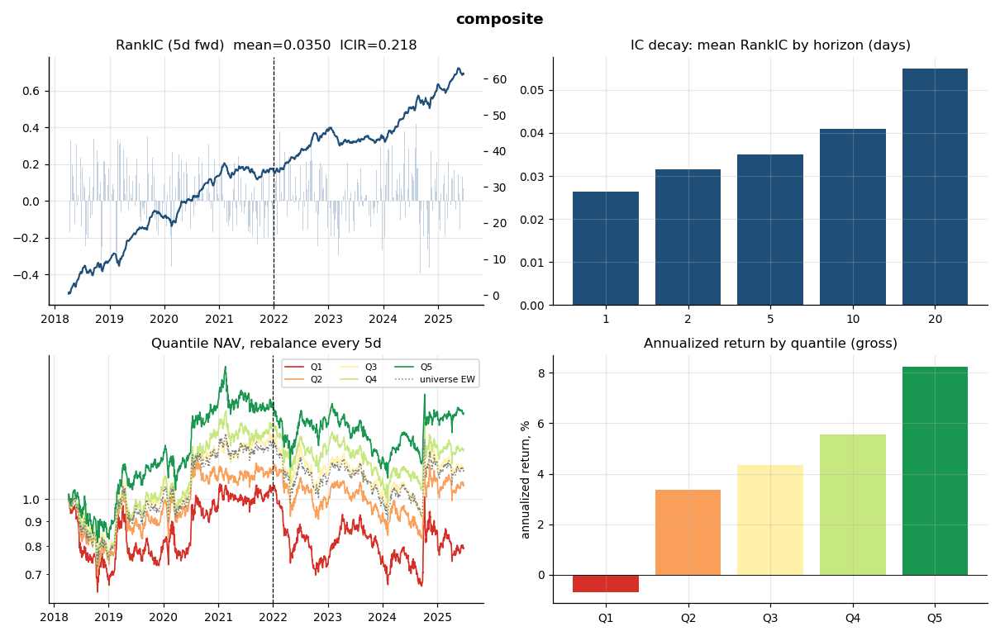
